# AWS Identity Center access baseline (Terraform)

This project replaces a shared root login with named, MFA-protected users who get least-privilege access by team, built with AWS IAM Identity Center and Terraform.

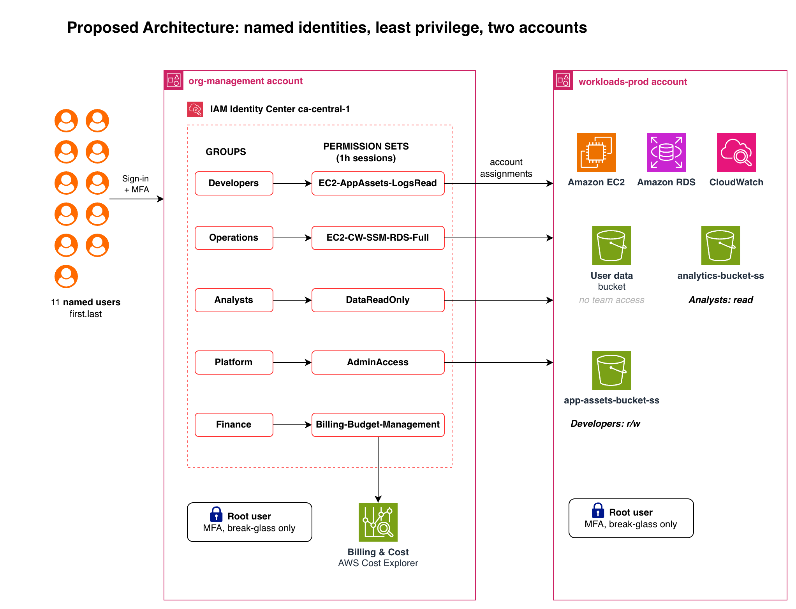

## 1. The problem

A 10-person startup launched its product three months ago, and everyone on the team was using the AWS root user for their work. There was no MFA, no password policy, and the credentials were shared in the team chat. There was no separation of permissions by role, so everyone had access to everything, and because everyone used one login, there was no record of who did what.

That means a single leaked password breaks all three pillars of the CIA triad at once:

| Pillar | What a leaked root password allows |
|---|---|
| Confidentiality | Anyone can read users' data |
| Integrity | Anyone can change anything, and nobody can tell who did it |
| Availability | Anyone can delete everything, including the account |

The team needed access split by role:

| Team | People | Needs |
|---|---|---|
| Developers | 4 | EC2 management, S3 access for application files, viewing CloudWatch logs |
| Operations | 2 | Full EC2 and CloudWatch, Systems Manager, RDS management |
| Finance | 1 | Cost Explorer, AWS Budgets, read-only resource access |
| Data Analysts | 3 | Read-only S3 and database access |

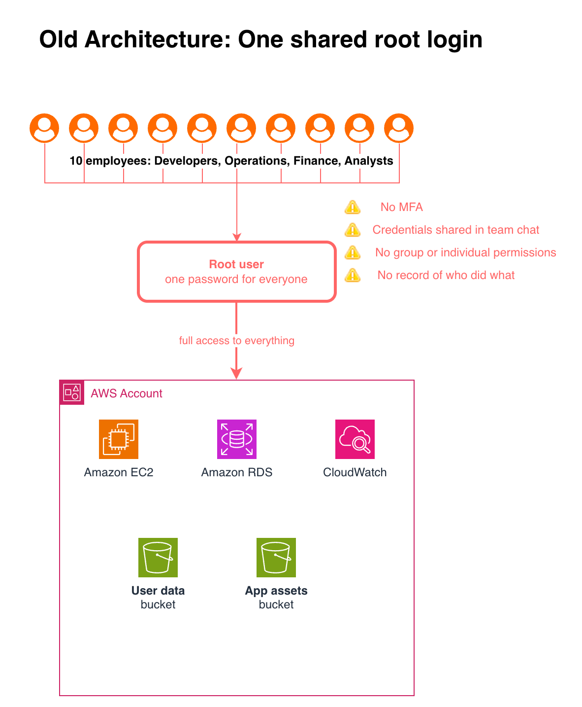

## 2. What I built

I redesigned access around AWS IAM Identity Center, running in a dedicated org-management account. Each person has a named user in a team group, and each team gets its own custom permission set. Users sign in once to the Identity Center portal and land in the account their team works in: every team works in a separate workloads-prod account except Finance, which is the only team with access to org-management, and only to billing and cost management. Everything is defined and deployed with Terraform.

Alongside the four teams, a **Platform** group administers the accounts with short-lived admin access, so that nobody needs the root user for day-to-day work. Without it, the only way to administer the accounts would be the root user, the very login this project retires. Where the access differs from the list above, the reasons are under [The decisions](#3-the-decisions).

| Team | People | Permission set | Account | Access |
|---|---|---|---|---|
| Developers | 4 | `EC2-AppAssets-LogsRead` | workloads-prod | EC2 full, CloudWatch Logs read, read/write/delete objects in `app-assets-bucket-ss` only |
| Operations | 2 | `EC2-CW-SSM-RDS-Full` | workloads-prod | EC2, CloudWatch, Systems Manager, RDS full |
| Analysts | 3 | `DataReadOnly` | workloads-prod | List and read `analytics-bucket-ss` only |
| Finance | 1 | `Billing-Budget-Management` | org-management | Billing, Budgets, Cost Explorer |
| Platform | 1 | `AdminAccess` | workloads-prod | Administrator, for running the accounts without root |

All permission sets use 1-hour sessions. MFA is required at every sign-in.

## 3. The decisions

**IAM Identity Center over IAM users.** Users sign in through one portal and receive temporary credentials that expire with their session, so there are no long-lived access keys to leak, and people are managed centrally instead of account by account.

**Two accounts.** Nothing runs in the management account. It controls the whole organization, and guardrails like service control policies don't apply to it, so one compromised credential there could change anything. Workloads live in a separate workloads-prod account.

**Named users, not shared seats.** Every person has their own `first.last` user, which gives non-repudiation: every action is tied to one person. My test denials show it, naming both the user and the permission set (`AWSReservedSSO_DataReadOnly_.../sofia.alvarez`).

**MFA on every sign-in.** MFA is always on, not context-aware, and users must register a device at first sign-in. A password alone is no longer enough, which closes the exact gap in the original setup, where one leaked password meant full access.

**Developers: object actions only.** Developers get access to list, read, write and delete files in the app-assets bucket, and nothing else in S3. I rejected `s3:*` because it would also let them delete the bucket, make it public, or turn off its encryption, none of which their job requires.

**Analysts: one bucket, no bucket list.** Analysts get access to list and read files in one analytics bucket, and nothing else in S3. I left out `s3:ListAllMyBuckets`, which lists every bucket name in the account; even names can reveal information, and opening their bucket by direct link or the CLI is a small cost. Database access is not part of this build (see [Limitations](#6-limitations-and-next-steps)).

**Finance: billing only, in the management account.** Finance gets access to billing, budgets and Cost Explorer, and nothing else. I rejected `ReadOnlyAccess` because it can read data, including files in the user-data bucket. I also left out view-only resource access: Cost Explorer shows spend by service and tag, and investigating resources is Operations' job. That's separation of duties. Finance sits in the management account because that's where consolidated billing lives.

## 4. What broke

**One missing "s" locked a team out.** I created the developers' bucket as `app-asset-bucket-ss`, but my policy pointed at `app-assets-bucket-ss`: a single missing "s", which is very easy to miss. Nothing warned me: the policy was valid and the bucket existed, they just didn't match. I only caught it when a test came back `NoSuchBucket` instead of `AccessDenied`. I deleted the bucket and recreated it with the right name. The lesson: be careful when typing names, and test access instead of assuming it works.

**I enabled Identity Center as the root user.** I thought the Identity Center management setup had to be done from the root user, so I enabled it there. As soon as I was done creating the instance, I realized root access is exactly what this project needs to keep out of day-to-day work, and it wasn't needed: an admin user can do it. So I deleted it and enabled it again from an admin user.

## 5. Verification

My analyst policy grants `s3:ListBucket`, not `s3:ListAllMyBuckets`, so she can see the files inside her bucket but not the names of other buckets. The S3 console's home page needs `ListAllMyBuckets`, so instead of the console I tested her access through the CLI.

Signed in as analyst `sofia.alvarez` through the CLI with her own SSO profile:

| Test | Expected | Result |
|---|---|---|
| List `analytics-bucket-ss` | Allowed | ✅ |
| Read a file in it | Allowed | ✅ |
| Write to it | Denied | ✅ AccessDenied |
| List all buckets | Denied | ✅ AccessDenied |
| List `app-assets-bucket-ss` | Denied | ✅ AccessDenied |

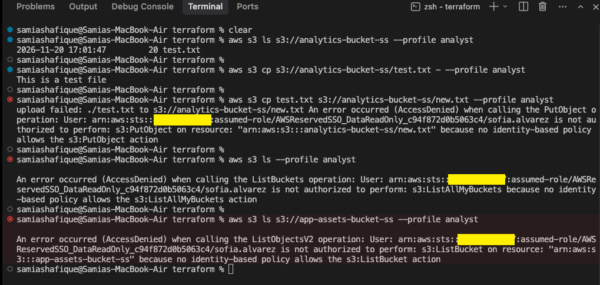

In the console she is also denied IAM and EC2:

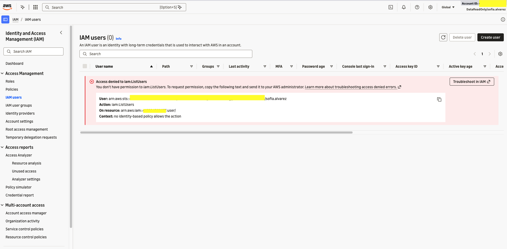
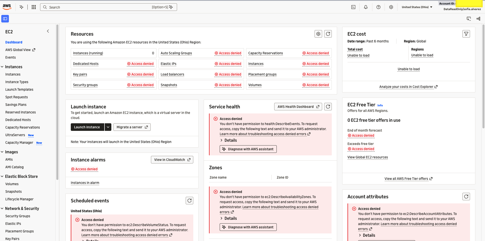

<details>
<summary>Identity Center screenshots: users, groups, permission sets, assignments, MFA</summary>

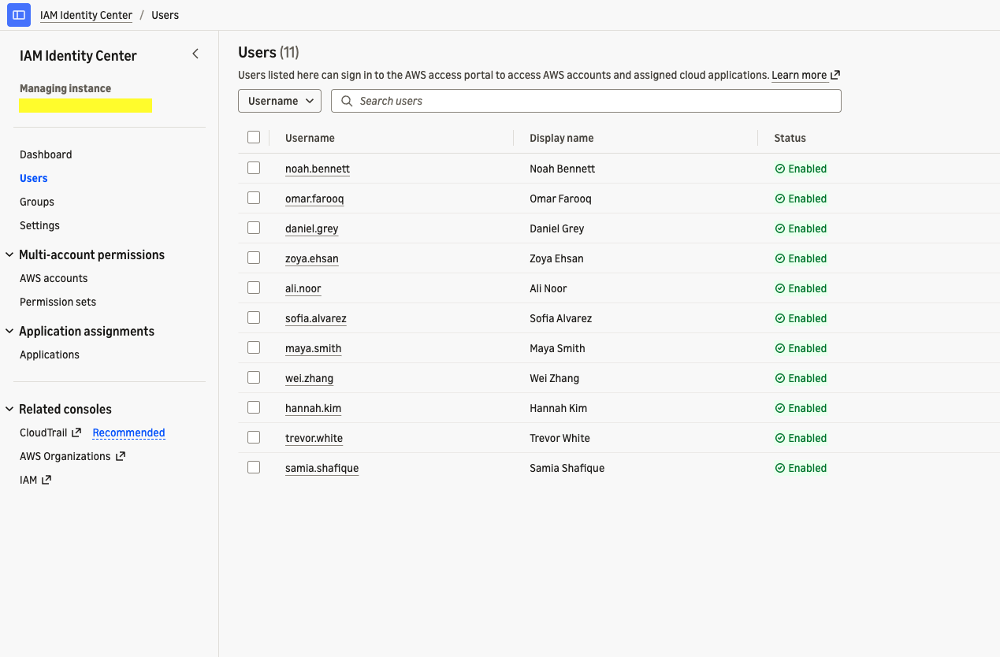
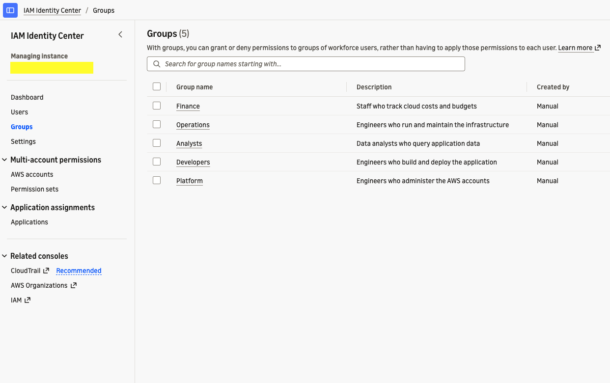
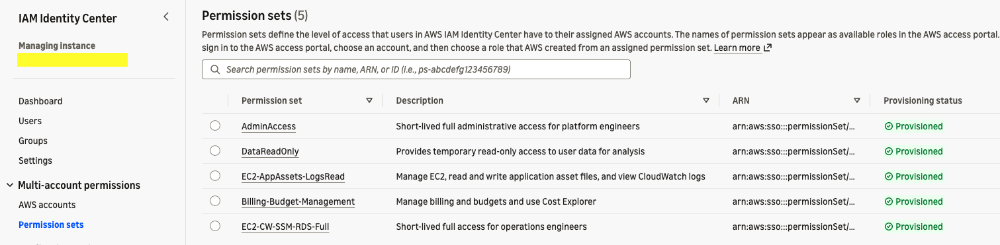
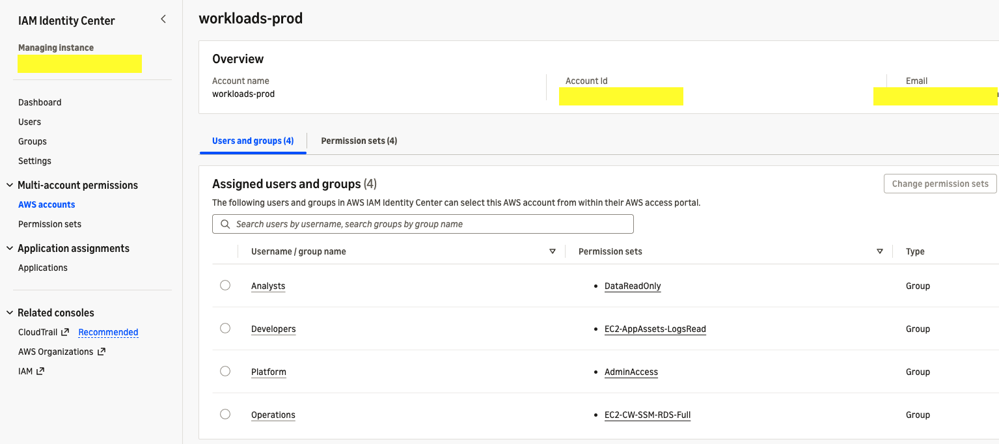
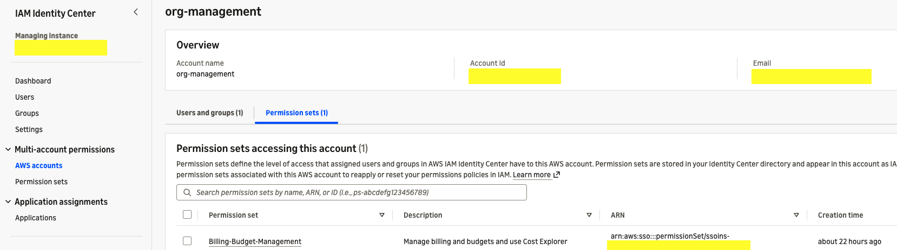
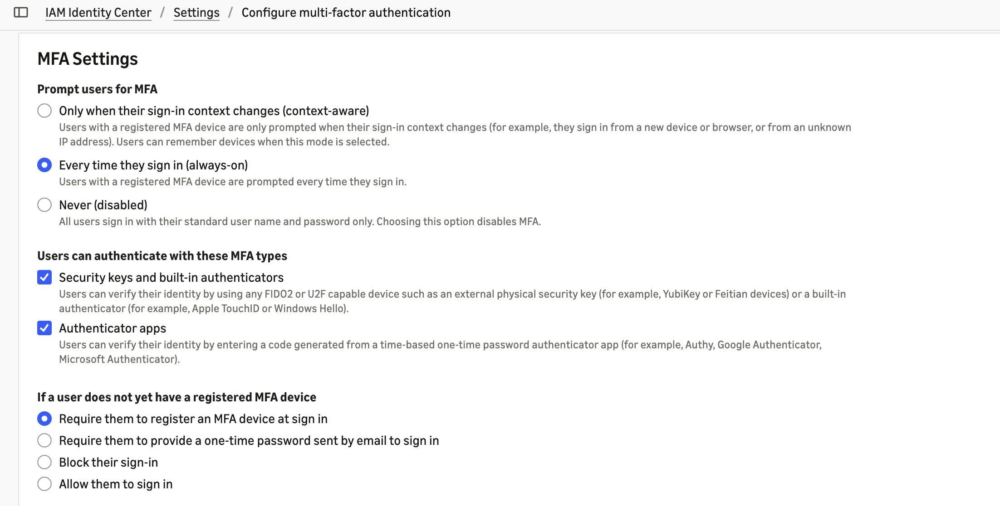
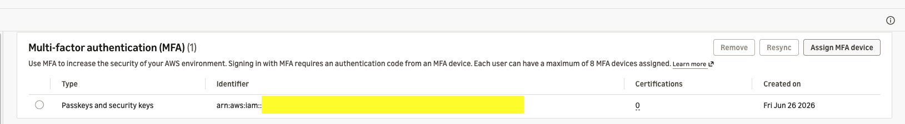

</details>

## 6. Limitations and next steps

Some parts can't be done in Terraform, or weren't in scope for this build:

| Limitation | Detail |
|---|---|
| Two manual steps | Enabling Identity Center and turning on root MFA are console-only. There's no API for either, so they're documented here rather than coded |
| Password policy | Identity Center's built-in directory enforces AWS's own [password requirements](https://docs.aws.amazon.com/singlesignon/latest/userguide/password-requirements.html), which can't be customised. The strong-password requirement is met by those rules plus MFA on every sign-in |
| User onboarding | Users were created without email addresses, so an admin issues each one a one-time password. In production, each user's work email would be added so they can onboard themselves |
| Test resources only | The two S3 buckets were created with the CLI to test the policies. The application's own infrastructure is out of scope for this repo |
| Analysts' database access | Not built, because there's no database in the sandbox. In production it would use IAM database authentication to a read replica, with a database user that can only run SELECT |

Next steps:

| Next | Why |
|---|---|
| Run changes through a plan/apply pipeline | My [Terraform portfolio project](https://github.com/samiashafique/terraform-portfolio-project) already has one, with an approval gate before every apply |
| Alert on root user sign-in | Root should only be used in an emergency, so any sign-in deserves a notification (CloudTrail + EventBridge) |
| Connect an external identity provider | So joiners and leavers are handled in one place, such as Microsoft Entra ID or Okta |
| CloudFormation and CDK versions | The same design in AWS's own IaC tools, for comparison with Terraform |

## How to run

Prerequisites: an AWS Organization with IAM Identity Center enabled in `ca-central-1`, and credentials for the management account.

```bash
cd terraform
cp terraform.tfvars.example terraform.tfvars   # set workloads_prod_account_id
terraform init
terraform plan
terraform apply
```

```
terraform/
├── providers.tf        AWS provider, ca-central-1
├── main.tf             instance lookup, teams, users, memberships, assignment map
├── permission-sets.tf  five permission sets and their policies
├── assignments.tf      one for_each assignment per team
├── variables.tf        workloads account ID
└── outputs.tf
```
